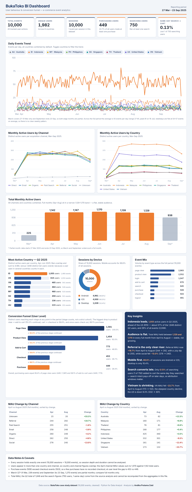
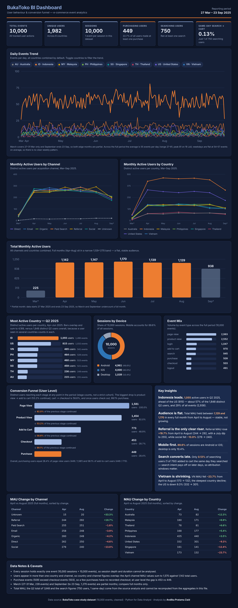

# BukaToko BI Dashboard

An interactive, single-file business intelligence dashboard analysing user behaviour and the conversion funnel of a fictional e-commerce platform, **BukaToko**, based on 10,000 tracked events (27 Mar – 23 Sep 2025).

Built with plain HTML, CSS and JavaScript (hand-rolled SVG charts). No frameworks, no build step, no external dependencies.

> **Live demo:** [BukaToko BI Dashboard](https://andikapratamazaid.github.io/bukatoko-bi-dashboard/)



<details>
<summary>Dark mode</summary>



</details>

---

## Key Findings

| Finding | Evidence |
| --- | --- |
| **Indonesia is the most active market** | 1,055 active users in Q2 2025, ahead of the US (815); about 57% of the 1,848 distinct Q2 users |
| **The audience is flat, not growing** | Total MAU stays between 1,129 and 1,170 in every full month (Apr–Aug) |
| **Referral is the only clear growth channel** | Referral MAU +19.7% Apr → Aug (244 → 292); social −13.0% (276 → 240) |
| **Vietnam is the steepest decliner** | VN MAU −23.7% Apr → Aug (173 → 132); US −9.3% |
| **Mobile first** | 89.6% of sessions are Android or iOS; desktop is 10.4% |
| **Biggest funnel leak is product view → add to cart** | Only 53.2% of product viewers add to cart; once users reach checkout, 99.1% purchase |
| **Search intent pays off late** | Only 1 of 750 searching users (0.13%) added to cart on the same day |

## Funnel (user level)

| Stage | Users | Step conversion |
| --- | ---: | ---: |
| Page view | 1,581 | – |
| Product view | 1,454 | 92.0% |
| Add to cart | 773 | 53.2% |
| Checkout | 453 | 58.6% |
| Purchase | 449 | 99.1% |

Purchasing users equal 28.4% of page-view users (449 / 1,581) and 22.7% of all 1,982 users.

## Dashboard Sections

1. **KPI cards:** events, unique users, sessions, purchasing users, searching users, same-day search → cart rate
2. **Daily events trend:** filterable by country (toggle chips), with hover tooltips
3. **Monthly active users by channel:** togglable legend
4. **Monthly active users by country:** togglable legend
5. **Total monthly active users:** partial months (Mar, Sep) are flagged
6. **Most active country in Q2 2025**
7. **Sessions by device:** donut chart
8. **Event mix:** volume by event type
9. **Conversion funnel** and **Key Insights**
10. **MAU change tables:** April vs August by channel and by country
11. **Data notes and caveats**

Light and dark mode are supported automatically, and the layout is responsive down to mobile widths.

## Dataset Summary

| Metric | Value |
| --- | ---: |
| Events | 10,000 |
| Unique users | 1,982 |
| Sessions | 10,000 |
| Countries | 8 (ID, US, VN, PH, MY, SG, TH, AU) |
| Period | 27 Mar – 23 Sep 2025 (181 days) |
| Average events per day | 55 (range 27–81) |
| Device split | Android 4,961 · iOS 4,000 · Desktop 1,039 |

Event types: `page_view` (2,983), `product_view` (2,552), `login` (1,047), `add_to_cart` (970), `search` (945), `purchase` (509), `checkout` (503), `logout` (491).

## Data Notes and Caveats

- **One event per session.** 10,000 sessions equal 10,000 events, so session depth and duration cannot be analysed.
- **Overlapping segments.** Users appear in more than one country and channel, so per-country and per-channel figures overlap and must not be added together (e.g. Q2 country users sum to 4,189 against 1,848 distinct users).
- **Purchase vs checkout events.** Purchase events (509) exceed checkout events (503), so a few purchases have no recorded checkout. At user level the gap is 453 vs 449.
- **Partial months.** March (27–31 Mar) and September (to 23 Sep) are incomplete; compare full months only.
- **Funnel is not a strict cohort.** Each stage counts distinct users who reached it at any point in the period.
- **Not recomputable from this repo.** Total MAU, the Q2 distinct total (1,848) and the search figures (750 users, 1 same-day) come from the original Python analysis. Only the aggregates are embedded in the dashboard.

## Verification

All embedded aggregates were cross-checked against each other:

- Daily series sum to exactly 10,000 events
- Q2 events per country match the daily series
- Device and event-mix totals sum to 10,000
- Funnel conversions and MAU percentage changes were recomputed

## Getting Started

No installation needed.

```bash
git clone https://github.com/<your-username>/bukatoko-bi-dashboard.git
cd bukatoko-bi-dashboard
open index.html        # macOS; on Windows use: start index.html
```

### Deploy with GitHub Pages

1. Rename `BukaToko_BI_Dashboard.html` to `index.html`
2. Go to **Settings → Pages**
3. Select **Deploy from a branch**, choose `main` and `/ (root)`
4. Your dashboard will be live at `https://<your-username>.github.io/bukatoko-bi-dashboard/`

## Project Structure

```
bukatoko-bi-dashboard/
├── index.html      # The complete dashboard (HTML + CSS + JS + embedded data)
├── docs/
│   ├── screenshot.png        # Light mode preview
│   └── screenshot-dark.png   # Dark mode preview
└── README.md
```

## Tech Stack

- **Analysis:** Python (data cleaning and aggregation)
- **Visualisation:** vanilla JavaScript with hand-built SVG charts
- **Styling:** CSS custom properties, CSS grid, `prefers-color-scheme` theming

## Updating the Data

All figures live in the `DATA` object near the top of the `<script>` block. Replace the values there and the charts, KPIs and tables will re-render. Static text (KPI cards, insights, footnotes) is written in the HTML and should be updated to match.

## Author

**Andika Pratama Zaid**
Python for Data Analyst case study

## License

Released under the [MIT License](LICENSE). _Add a `LICENSE` file, or change this line to the licence you prefer._
